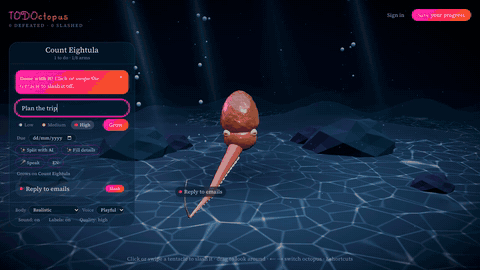
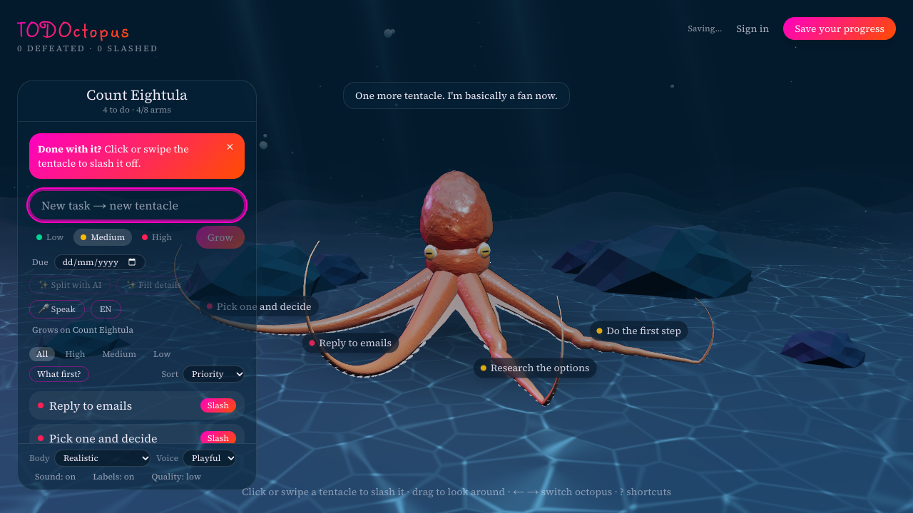
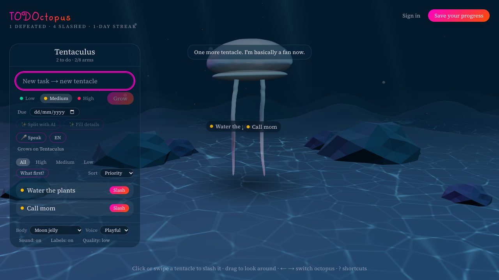
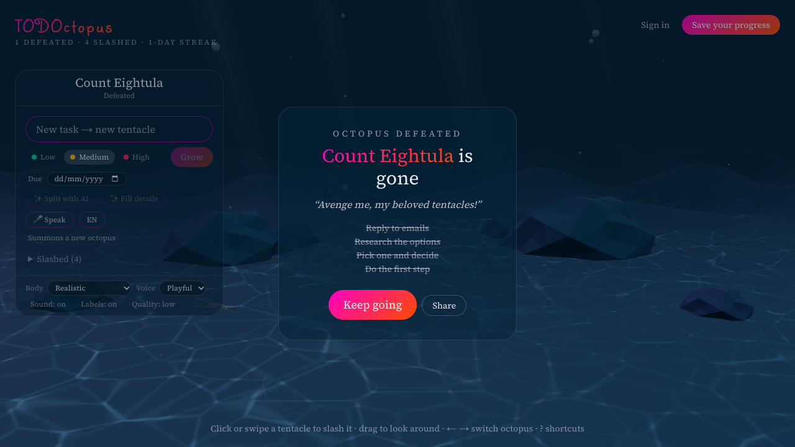

# TODOctopus 🐙

A to-do list where every task is a tentacle of a living 3D octopus. Add a task and a tentacle grows. Finish it and you slash the tentacle off. Slash them all and the octopus is defeated.

**Live:** https://todoctopus.vercel.app



| Realistic body | Moon jelly body | Defeat card |
|---|---|---|
|  |  |  |

## How it plays

- Each octopus has up to eight tentacles. The next task after that summons a new octopus.
- **Slash** a tentacle by clicking it, swiping across it, or pressing *Slash* in the list. **Delete** (a mistake) retracts it instead.
- Give a task a **priority** (low, medium, high) and an optional **due date**. A tentacle past its due date glows angry red and its label turns red too.
- **Sort** the list by priority, due date, newest or oldest, and filter it.
- Pick a **body** for your octopus: Classic, Common, Giant Pacific, Blue-ringed, Realistic, a translucent Moon jelly, or *Surprise me* for a random one each time.
- Defeated octopuses go to the trophy room (`/trophies`) with your streak, an activity chart and 11 **achievements** (you get a toast when one unlocks). Share a defeat or a trophy with the share button: the link (`/s`) previews as a generated card (`/api/og`) with the octopus's name and your numbers, and only the game's own octopus names can appear on it.
- **AI helpers** (optional, off without an API key, and only after the player allows them): split a task into steps, fill the form from a sentence ("call mom tomorrow, important", Arabic works too), speak a task, and a defeated octopus's last words. The AI only suggests; you still press Grow. Task text is sent to Anthropic's Claude; see `/about#ai`.
- The octopus **talks back** (Playful, Savage, Kind or Quiet), and **What first?** picks the tentacle to tackle next: overdue, then due soon, then high priority.
- Sounds are synthesized in the browser, with haptics on phones. Toggle them with the sound button.
- Nobody has to sign up. The first task silently creates a guest account on the server; *Save your progress* turns it into a real account and keeps everything.

### Keyboard

| Key | Action |
|---|---|
| `J` / `K` | Select the next / previous tentacle |
| `W` | What first? Highlights the tentacle to tackle next |
| `S` | Slash the selected tentacle |
| `N` | Focus the new-task field |
| `M` | Mute / unmute |
| `←` `→` | Switch octopus |
| `?` | Show the shortcut list |
| `Esc` | Close a dialog or clear the selection |

## Use it from Claude (MCP)

TODOctopus is also an [MCP](https://modelcontextprotocol.io) server, so Claude Code, Claude Desktop or any MCP client can manage your octopus ("add *buy milk* to my octopus").

1. Create an account (*Save your progress*), then open **API tokens** in the account menu (`/settings/tokens`) and create a token. It is shown once; only its hash is stored.
2. Connect a client, for example Claude Code:

```bash
claude mcp add --transport http todoctopus https://todoctopus.vercel.app/api/mcp \
  --header "Authorization: Bearer <your token>"
```

Tools: `list_tasks`, `add_task`, `slash_task`, `list_octopuses`, `get_stats`. Every change goes through the same rules as the browser. It can't delete anything or touch your account. Tokens are for accounts only (not guests), limited to five each, and can be revoked any time. The game picks up changes when you return to its tab.

## Stack

| | |
|---|---|
| App | Next.js 16 (App Router), React 19, TypeScript, Tailwind v4 |
| 3D | React Three Fiber + drei + postprocessing. The octopus is procedural (Verlet-chain tentacles), not a model file |
| Backend | Server actions + Neon Postgres via Drizzle ORM |
| AI | Claude Haiku through the Vercel AI SDK, behind a daily per-user limit; every feature has a non-AI fallback |
| Auth | Better Auth: email/password and the anonymous (guest) plugin; personal API tokens for MCP |
| MCP | Official MCP SDK, stateless Streamable HTTP at `/api/mcp` |
| Tests | Vitest (game rules, store, helpers) and Playwright (end-to-end) |
| Hosting | Vercel, with a daily cron that removes guests idle for 90 days |

The rules live in [`src/game/rules.ts`](src/game/rules.ts) as pure commands. The browser applies a command instantly, then the server replays the same command inside a transaction to make it official. See [`docs/rebuild-plan.md`](docs/rebuild-plan.md) for the design notes.

## Run it locally

```bash
pnpm install
cp .env.example .env.local   # then fill it in (below)
pnpm db:migrate
pnpm dev
```

Environment variables:

| Variable | Purpose |
|---|---|
| `DATABASE_URL` | Neon Postgres connection string |
| `BETTER_AUTH_SECRET` | Long random string (`openssl rand -base64 32`) |
| `BETTER_AUTH_URL` | The site's own URL, e.g. `http://localhost:3000` |
| `CRON_SECRET` | Protects `/api/cron/cleanup` |
| `NEXT_PUBLIC_SITE_URL` | Optional. Public URL for the sitemap and social cards |
| `ANTHROPIC_API_KEY` | Optional. Turns the AI helpers on. Set a monthly spend limit in the Anthropic console |
| `AI_ENABLED` | Optional. `0` switches every AI helper off |
| `AI_MOCK` | Tests only. `1` answers from canned data instead of calling the model |

## Scripts

```bash
pnpm dev         # dev server
pnpm build       # production build
pnpm lint        # ESLint
pnpm typecheck   # next typegen + tsc
pnpm test        # unit tests
pnpm e2e         # Playwright (builds and starts the app on :3100)
pnpm db:generate # new migration from src/db/schema.ts
pnpm db:migrate  # apply migrations
pnpm media       # record the README demo (video + screenshots, needs system Chrome)
pnpm media:gif   # turn the recording into docs/media/demo.gif (needs ffmpeg)
```

`pnpm e2e` uses the database in `.env.local`, so point that at a dev branch, never production. It uses your installed Chrome (set `CI=1` to use Playwright's Chromium) and deletes the test accounts it creates. It also sets `E2E_NO_RATE_LIMIT=1` on its own server so sign-in rate limits don't make it flaky; never set that in production.

## Deploying

Vercel builds with `pnpm vercel-build`, which applies pending database migrations (`drizzle-kit migrate`) and then runs `next build`, so each deploy migrates the database it points at. Set the environment variables above in the Vercel project (Production and Preview).
